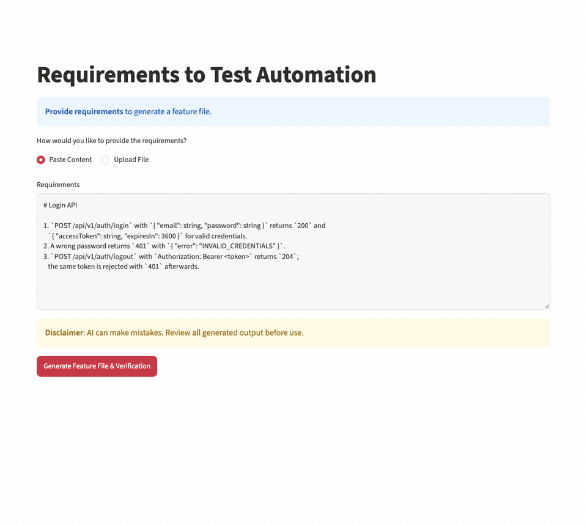
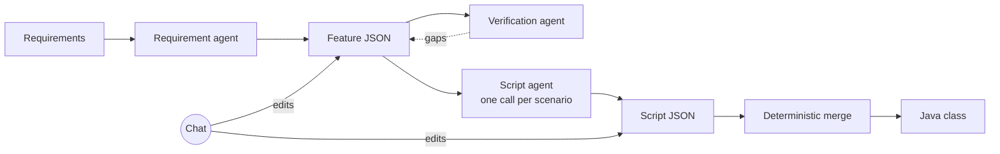

# Requirements to Test Automation

Turn plain-language requirements into Gherkin feature files and Java step definitions, then refine both through chat. Supports API tests (REST Assured) and UI tests (Selenium), with Cucumber and TestNG.



<sub>Recorded with `openai/gpt-oss-120b` on Groq using [`examples/login_api_requirements.md`](examples/login_api_requirements.md).</sub>

## How it works



1. **Requirement agent** writes a feature file as JSON (feature, background, scenarios, examples).
2. **Verification agent** checks it against the original requirements and lists gaps.
3. **Chat refinement** changes the feature. You see a diff and apply or reject each change. Every applied change becomes a new version you can step back through.
4. **Script agent** generates step definitions **one scenario at a time**, so long features don't hit the context limit.
5. The per-scenario classes are **merged deterministically**: imports and fields are de-duplicated, methods are concatenated.
6. **Chat refinement** on the merged class, again with a diff and apply/reject.

### Why JSON in the middle

Asking an LLM to rewrite a whole file for a one-line change is slow and risky: it drops lines, reorders methods, and "fixes" code nobody asked it to touch. Here, both the feature and the Java class are kept as JSON. For an edit, the model returns a list of small operations instead of a new file:

```json
{"intent": "change",
 "explanation": "Renamed the class and added an assertion import.",
 "modifications": [
   {"action": "rename_class", "new_name": "LoginApiTests"},
   {"action": "add_import", "import": "org.testng.Assert"}
 ]}
```

Plain Python applies these ops, so code you didn't mention stays exactly the same. A full rewrite only happens when you ask to regenerate, or as a fallback when the model's reply can't be parsed. The conversion and merge code in [`core/`](core) has no LLM dependency and is covered by unit tests.

## Quickstart

```bash
git clone https://github.com/jodha-rituraj/ai-automation-from-requirements.git
cd ai-automation-from-requirements
python -m venv .venv && source .venv/bin/activate
pip install -r requirements.txt
cp .env.example .env   # add a Groq key, or paste one into the sidebar later
streamlit run app.py
```

You need Python 3.10+ and an API key from one of:
- [Groq](https://console.groq.com/keys): free tier, uses `openai/gpt-oss-120b`.
- [OpenRouter](https://openrouter.ai/keys): any model it hosts; defaults to `openai/gpt-oss-120b`.
- Azure OpenAI.

Try it with [`examples/login_api_requirements.md`](examples/login_api_requirements.md).

## Project layout

```
app.py        Streamlit UI and workflow state
agents/       LLM-facing agents: requirement, verification, automation script
core/         Deterministic logic: Gherkin <-> JSON, Java <-> JSON, merging, LLM factory
prompts/      System prompts for each agent
tests/        Unit tests for core/ and an end-to-end app test with a fake LLM
examples/     Sample requirements
```

## Tests

```bash
pip install pytest
pytest
```

The end-to-end test drives the Streamlit app through the whole flow, including both chat edits, with a scripted fake model. No API key or network access is needed.

## Limitations

- The Java parser is regex-based and assumes one top-level class per file in common step-definition style. It isn't a full Java parser.
- Generated code targets a typical REST Assured / Selenium + Cucumber + TestNG setup. Use the "additional context" box to describe your own framework's helpers and conventions.
- Review generated tests before using them. The verification agent reduces gaps but doesn't remove them.
- Groq's free tier allows 8,000 tokens per minute. Chat edits on large generated classes can exceed that; use OpenRouter, Azure OpenAI or a paid Groq tier for bigger features.

## Future work

- **VS Code extension:** generate and refine scripts from inside the editor, with output written straight into the test source tree.
- More output targets: Playwright, Karate, pytest-bdd.

## License

[MIT](LICENSE)
